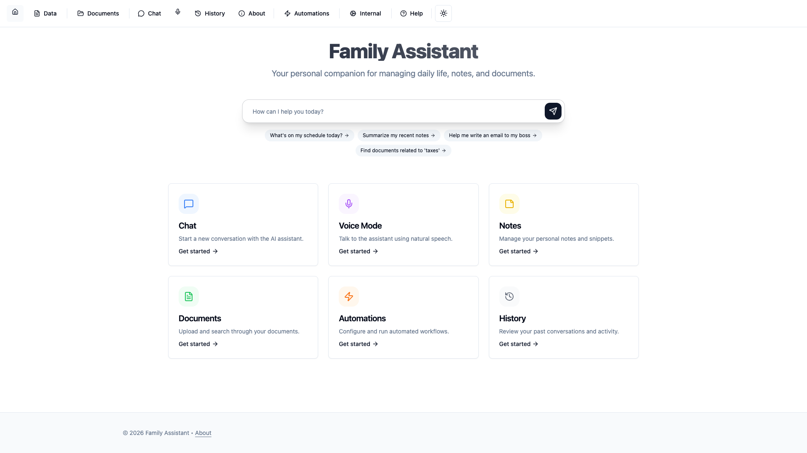
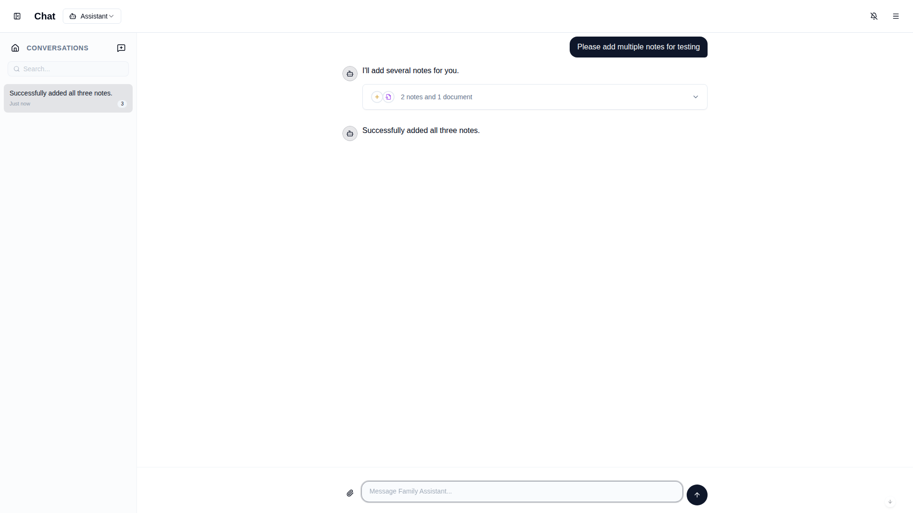

# Interfaces: Telegram, Web, and iOS

**What's here:** the ways you can talk to the assistant, what Telegram and the web interface offer,
push notifications, messaging other household members, and how background delegations work.

Related interface guides:

- **[threads.md](threads.md)** — **Home** and **threads** in the web and iOS apps
- **[ios.md](ios.md)** — the native iOS app, Apple Watch setup, and Siri / Shortcuts
- **[voice.md](voice.md)** — spoken voice conversations on the web, iOS, Apple Watch, and CarPlay

## Telegram (primary)

Find the bot contact in Telegram — whoever set up the assistant will tell you its name — and send
messages as you would to a person.

- **Rich formatting and tables:** responses support full Markdown including headers, bold/italic,
  lists, code blocks, and aligned tables.
- **Slash commands** switch the assistant into a specialised mode for a request, such as `/browse`
  for complex web tasks. See [slash-commands.md](slash-commands.md).
- **Reply to a message** using Telegram's reply feature when following up on something specific; it
  also keeps the conversation in a specialised mode if you were using one.
- **Send photos and files** directly in a message with your question as the caption. A whole album
  is treated as one message, so you get one answer covering all the photos.
- **Several messages in a row are read together.** The assistant waits about five seconds after your
  last message before it starts, so a question followed by a forwarded message or a file (for
  example "can you print this?" and then the PDF) is answered as one request.
- **Follow up mid-reply:** sending an ordinary message while the assistant is still working folds it
  into the reply being prepared. A photo or file sent mid-reply is answered on its own once the
  current reply finishes. A slash command is the exception: wait for the current reply to finish or
  send **`/interrupt`** first.
- **`/interrupt`** stops the request currently being processed in that chat.
- **Restarts:** if the assistant restarts while answering, it picks the reply back up within a
  minute or two (except slash-command requests, which should be sent again).
- **Confirmations** arrive as inline **✅ Confirm** and **❌ Cancel** buttons. See
  [confirmations-and-safety.md](confirmations-and-safety.md).

## Web interface

Open the web app at `{{ SERVER_URL }}`. It works on computers, tablets, and phones, and supports
light, dark, and system themes.

Every page shares the left navigation sidebar (collapsible to an icon strip on desktop, always an
icon strip on tablets, and a top-left menu button on phones). Clicking the Family Assistant name or
logo returns to the landing page. Help, About, and the theme control sit at the bottom of the
navigation. In **System → Tools**, use **Search tools** to filter tools by name or description.

### Chat

Replies stream in as they are generated. Where threads are enabled, Chat opens on **Home** and tasks
run in threads; see [threads.md](threads.md).

**Tool call groups.** A group of tool calls appears as a single collapsible line between the text
written before and after it. While running, it names the current step and how many steps have
finished; when done, it names the most significant step (preferring state changes over lookups). A
group expands automatically only when a step needs your approval. Open a group to see each step's
status (running, waiting for approval, succeeded with a checkmark, failed with its error,
declined/expired, or cut off before reporting back) and click **Details** to view or copy raw
arguments and results.

**Reply actions (web and iOS):**

- **Copy response:** Copies the reply text to the clipboard (shows an error if clipboard access is
  blocked).
- **Good response / Bad response (thumbs up / down):** Saves your private rating on that reply
  (press again to remove it). Thumbs down offers an optional comment box.
- **Which model answered (eye button):** Shows the profile, intelligence level (and who chose it),
  exact model and provider, and any model-comparison experiment. On replies in an active model
  comparison, the eye button appears only while your rating is set so knowing the model cannot bias
  the rating.

**Conversations, drafts, and profiles:**

- Scroll to the top and select **Load earlier messages** to page through older history.
- Reopening a conversation resumes its original profile. Switching profiles mid-conversation starts
  a fresh chat in the new profile and carries over your unsent draft (on an empty chat it switches
  in place).
- Each conversation keeps its own unsent text and attached files while the page or app stays open.
  If a conversation fails to load, Chat offers **Retry** and blocks sending until history loads.
- **Conversation labels:** About a minute after a conversation goes quiet, the sidebar, History
  page, and iOS chat list replace the latest-message preview with a short summary title.

**Share a conversation.** Select the share icon in the chat header and choose **Create and copy
link** (on iOS, use the share sheet). **Replace and copy link** immediately invalidates the old link
even if copying fails; **Stop sharing** revokes access. After leaving or reloading the conversation,
the existing URL cannot be viewed again without replacing it. The recipient must sign in as an
authorized household user; the shared chat does not appear in their history list, opens read-only
(with expandable tool call groups), and includes newer messages when refreshed. Treat the link as
private convenience within the household, not a security boundary against another authorized user
who obtains the URL.

**Stop or steer a running reply:**

- Leave the message box empty and press **Stop** to halt the reply immediately.
- Type a follow-up note and press **Steer** to fold the correction into the running turn without
  starting over.

**Replies survive a restart.** If the server restarts mid-reply, it resumes within a minute or two
unless you sent a new message in the meantime or it was waiting on an approval prompt (which stays
valid). If it cannot continue, the reply is marked interrupted.

### Home and threads

When threads are turned on, Chat opens on **Home** and messages start or continue **threads**. For
how thread cards, states, side-panel navigation, **Continue in a thread**, **Move to thread**,
sharing from Home, and cross-conversation notes work, see [threads.md](threads.md).

### Voice

The **Voice** page holds a live spoken conversation with the assistant and saves the transcript to
Chat when finished. See [voice.md](voice.md).

### Pages

The navigation groups pages under **Knowledge**, **Automation**, **System**, and **Settings**:

- **Notes** — list, search, edit, and delete notes, and toggle automatic prompt inclusion.
- **Documents** — browse indexed documents with metadata and full text.
- **Vector Search** — semantic + keyword search grouped by document.
- **Upload Document** — upload PDFs, text, Word, HTML, and Markdown files for indexing.
- **History** — browse past conversations across Telegram, web, and email. Expand **Message
  Details** on any turn to see the answering mode, token usage, and (when published by the model) a
  **Thinking Summary**.
- **Tasks** — inspect background and scheduled task queue entries and retry failed tasks.
- **Automations** — create, inspect, enable/disable, and delete event or schedule automations and
  stored scripts. See [automations.md](automations.md).
- **Tools** — inspect tool schemas and test tools directly.
- **Settings → API Tokens** — create and revoke personal API tokens (copy a new token when shown;
  revoking asks for confirmation).
- **Settings → Connected Accounts** — link your Google account
  ([google-workspace.md](google-workspace.md)).
- **Error Logs** (`/errors`) — review application error reports
  ([troubleshooting.md](troubleshooting.md)).

## iOS app

The native iOS app provides **Chat**, **Voice**, **Notes**, **Documents**, and **More**, plus Apple
Watch support, Siri Shortcuts, and CarPlay voice calls. See [ios.md](ios.md) and
[voice.md](voice.md).

## Messaging other people in your household

The assistant can pass a message or attachment to another configured Family Assistant user in
whichever interface they use ("Tell Alice that dinner is ready", "Send this photo to John"). The
recipient must have messaged the assistant at least once so a conversation exists. In a direct
trusted chat it sends immediately; if the turn carries untrusted content (such as a forwarded
email), it asks for your approval first. See
[confirmations-and-safety.md](confirmations-and-safety.md).

## Push notifications

- **Browser (PWA):** install the web app to your device and allow notifications.
- **iOS app:** enable under **More → Settings → Enable Notifications** and grant iOS permission.

Notifications fire on every registered device when a web reply finishes while you are away, a
confirmation is waiting for approval, a background task fails after retries, or a worker or
long-running delegation completes. If you close the app or lose connectivity mid-reply, the server
finishes the turn and sends a push notification (or resumes streaming live if you reopen the
conversation while it is still running).

## Email and Claude connectors

- **Email:** email or forward messages to the assistant if configured; see [email.md](email.md).
- **Claude & MCP clients:** connect claude.ai, Claude Code, or the Claude API; see
  [connecting-claude.md](connecting-claude.md).

## Delegation to specialist modes

For browsing, deep research, visualization, coding, or council deliberation, the assistant may hand
off to a specialist profile:

- **Quick vs background handoffs:** Quick handoffs return inline. Longer ones return a
  `delegation_...` reference and leave your chat free; when the specialist finishes, it wakes the
  original assistant to post the follow-up in the same conversation (or in Chat for voice calls). In
  web chat, that wake turn streams just like a regular reply — you can watch it, press **Stop**, or
  steer it with a message, and if a result arrives while the assistant is already replying to you,
  it waits for that reply to finish. On channels without Stop (such as Telegram), the wake turn
  times out after about 30 minutes and posts a short note instead; the full result stays in the
  conversation so you can ask the assistant to continue from it.
- **Live status bar:** While a background delegation runs, web and iOS Chat show a status line above
  the composer (specialist name, state such as queued/working/council member count/finishing up, and
  start time; hover on web or use VoiceOver on iOS to read the request).
- **Continuing a delegation:** Follow-up questions can resume a previous delegation ID so the
  specialist keeps its context.
- **Attachments:** Files pass in both directions between your conversation and local or remote
  specialists (if a file exceeds the transfer size limit, the assistant tells you rather than
  dropping it).
- **Timeouts, late results, and cancellation:** If a remote specialist finishes after the assistant
  gave up waiting, the late result is still delivered to your conversation with a note explaining
  that it completed after the earlier failure notice. An empty result from a finished specialist is
  treated as a failure. When the assistant stops waiting on a run, it requests cancellation and
  reports that cancellation was requested until the specialist confirms it stopped.
- **Delivery fallback:** If a follow-up is too long for the chat channel (e.g. Telegram's length
  limit), the assistant sends a summary or saves a note while keeping the full result in the
  conversation history.
- **Worker tasks** (`spawn_worker`) are separate isolated container jobs identified by worker task
  IDs rather than `delegation_...` references.
