# Interfaces: Telegram, Web, and iOS

**What's here:** the ways you can talk to the assistant, what each one is good at, and the controls
available while a reply is being generated.

## Telegram (primary)

Find the bot contact in Telegram — whoever set up the assistant will tell you its name — and send
messages as you would to a person.

- **Rich formatting and tables:** responses support full standard Markdown including headers,
  bold/italic, bulleted/numbered lists, inline code/code blocks, and formatted tables with column
  alignments.
- **Slash commands** switch the assistant into a specialised mode for a request, for example
  `/browse` for complex web tasks. See [slash-commands.md](slash-commands.md).
- **Reply to a message** using Telegram's reply feature when you're following up on something
  specific. It tells the assistant exactly what you mean, and keeps the conversation in a
  specialised mode if you were using one.
- **Send photos and files** directly in a message, with your question as the caption. A whole album
  is treated as one message, so you get one answer covering all the photos.
- **Follow up mid-reply:** if you send another message while the assistant is still working, it
  folds that into the response it's already preparing. A slash command is the exception: it needs a
  request of its own, so the assistant asks you to wait for the current one to finish or
  `/interrupt` it.
- **`/interrupt`** stops the request currently being processed in that chat.
- **Restarts:** if the assistant restarts while it is answering, it picks the reply back up and
  sends it when it's done, usually within a minute or two. A slash-command request is not picked
  back up; send it again.
- **Confirmations** arrive as inline **✅ Confirm** and **❌ Cancel** buttons. See
  [confirmations-and-safety.md](confirmations-and-safety.md).

## Web interface

Open the web app at the URL your operator gave you (`{{ SERVER_URL }}`). It opens on the home page,
works on phones and tablets, and supports dark mode.

Every page, Chat included, shares the same navigation. On a computer it is the sidebar on the left;
the arrows at its top shrink it to a strip of icons (hover an icon for its name) and the choice is
remembered. On a tablet the sidebar is always that strip of icons. On a phone, the menu button at
the top left of every page opens the same list, and choosing a page closes it. The Family Assistant
name or logo takes you home. Help, About and the light, dark or system theme control sit at the
bottom of the navigation.

The home page cards can be opened with a tap, click, or keyboard. In **System → Tools**, use
**Search tools** to find a tool by its name or description before opening its details.

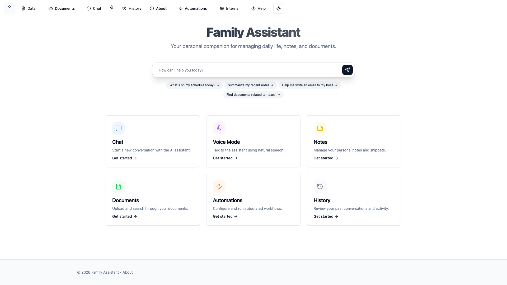 *The landing page gives quick access to
every section*

### Chat

Replies stream in as they're generated, and conversations are easy to switch between. Where threads
are turned on, the chat opens on Home and bigger jobs get threads of their own; see
[Home and threads](#home-and-threads) below.

The assistant's work shows up in the reply where it happened: a group of tool calls sits between the
text written before it and the text written after it. Each group is a single line. While it runs,
the line says what the assistant is doing right now, such as *Searching documents for “dentist”*,
along with how many steps have finished. When the group is done, the line names the step that
mattered most, such as *Added event “Swimming” and 2 more*. A step that changed something (saving a
note, adding an event, sending a message) is named ahead of a lookup. A group opens on its own only
when a step needs your approval.

Open a group to see every step. Common tools such as notes, calendar and documents have their own
views. Any other step says what it did and shows a short preview of what came back. Tap **Details**
to see the raw arguments and result in full, with buttons to copy them. You can open or close a
group at any time, and it stays the way you left it.

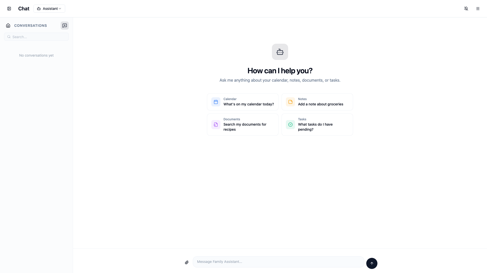 *The web chat interface*

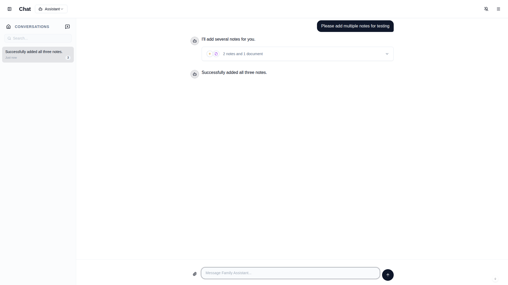 *Completed tool
calls stay collapsed while keeping the details available*

Each tool call says how it went, on the web and in the iOS app alike: running, waiting for your
approval, succeeded, failed, or not run (you declined it, its approval expired, or it is waiting for
your approval from the pending confirmations list). Only a call that succeeded shows a check mark,
and a failed call keeps its error message. A call that never reported back before its reply
finished, such as one cut off when you stopped a turn, says that no result was recorded rather than
looking finished or still running.

**Copy a reply.** Hover over an assistant reply or Tab to its **Copy response** button, then
activate it to copy the response text. A checkmark confirms success. If the browser cannot write to
the clipboard, an error appears below the reply; select the text and copy it manually instead.

**Rate a reply.** Next to **Copy response** are **Good response** (thumbs up) and **Bad response**
(thumbs down). Your rating is saved with that reply and shows again when you reopen the
conversation; press the same thumb again to take it back. After a thumbs down, a box asks what was
wrong. Filling it in is optional, but a few words make the rating far more useful when comparing how
different models do. Ratings are private to you and are only used to judge reply quality. In the iOS
app the two thumbs sit under each finished reply, and a thumbs down asks the same optional question.

A long conversation opens at its most recent messages. Scroll to the top and select **Load earlier
messages** to bring in older ones, as many times as you need to reach the start.

Reopening an existing conversation resumes it under the profile it started in, so follow-ups keep
their context. Starting a new chat uses whichever profile you last picked.

Each conversation keeps its own unsent draft. If you switch away part-way through a message, the
text and any files you attached stay with that conversation and are waiting in the message box when
you come back; the conversation you switch to shows only its own draft. Drafts last while the page
or app stays open. In the browser, if a conversation can't be loaded, Chat says so and offers
**Retry**, and it won't send anything into that conversation until its messages have loaded.

Switching profile part-way through a conversation starts a fresh chat in the new profile, so each
profile's context stays separate — but anything you have already typed comes with you, so you can
draft a message and then decide who should handle it. If the chat is still empty, switching just
changes the profile and keeps you where you are.

**Conversation labels.** The conversation list in the sidebar, on the History page and in the iOS
app labels each conversation with a short summary of what it is about, such as "Dentist moved to
Thursday 3pm". The summary is written a minute or so after the conversation goes quiet and updated
when it moves on; until then the list shows the latest message.

**Share a conversation.** Open a conversation that already has messages and select the share icon in
the chat header. In the web app, choose **Create and copy link**. The dialog shows a selectable URL
and **Copy link**; if clipboard access fails, select the URL or use **Retry copy**. Copying again
does not change the link. **Replace and copy link** immediately invalidates the previous link, even
if copying fails. **Stop sharing** makes the current link unavailable. Closing and reopening the
dialog keeps the URL while you stay in that conversation; after leaving or reloading, the existing
URL cannot be retrieved, so replace it if you need a new copy. Another window or device can also
replace or revoke the link. The iOS app opens its share sheet so you can choose where to send it.
The recipient must sign in as an authorized Family Assistant user, and the conversation does not
appear in their history list. On iPhone or iPad with the Family Assistant app installed, links from
`assistant.andrewgarrett.dev` open the transcript in a native read-only view; pull down to refresh
it. In iOS, selecting share again replaces the old link; select the stop-sharing icon to make the
current link unavailable. The transcript reflects messages added after the link was created when the
recipient refreshes it. Tool calls appear as collapsed groups, the same way they do in your own
chat; the recipient can expand a group to see what the assistant ran and what came back.

Treat the link as private within your household. It is meant to stop another authorized user from
casually browsing your history, not to protect a conversation from someone who obtains the link and
deliberately tries to access it.

**Stop or steer a running reply.** While the assistant is generating, the chat box doubles as a
steering box:

- Leave it empty and Send becomes **Stop** — the reply halts immediately and is marked "Stopped".
- Type a course correction ("actually, focus on next week") and the button becomes **Steer** — the
  assistant folds your note into the work it's already doing instead of starting over.

This is the web equivalent of Telegram's `/interrupt` and mid-reply follow-ups. Native iOS Chat has
the same controls.

**Replies survive a restart.** If the assistant is restarted while it is working on a web or iOS
reply, it picks the reply back up where it left off, usually within a minute or two, and the chat
fills in when it does. It won't carry on if you've sent something else in the meantime, or if the
reply was waiting for you to approve an action (the approval prompt still works). If it can't
continue, the reply is marked as interrupted, so ask again. Telegram replies are picked back up the
same way.

### Home and threads

Your household may have threads turned on. If the web chat opens on a page titled **Home**, they
are; otherwise the chat works as a list of separate conversations, as described above.

**Home** is one ongoing conversation with the assistant, and it is where the web chat opens. Ask
quick questions, make small changes, and set reminders there, the way you would message someone you
talk to every day. You don't need to pick a conversation or start a new one first. Home always uses
the main assistant, so the profile picker is locked while you are in it.

Some jobs outlive a single reply: they run in the background, wait on someone, take several steps
you'll want to follow, or are a project you'll come back to. For those, the assistant starts a
**thread** and says so in its reply. You can ask for one too, for example *"Start a thread to find
three plumbers and get quotes."* A thread is handled by whichever kind of assistant suits the job,
such as research or browsing, and keeps that choice for as long as it runs.

Where the assistant started a thread, Home shows a card for it. The card keeps itself up to date
rather than adding a message for every step. It shows:

- a coloured dot for where the thread stands: **Working**, **Waiting on you**, **Done**, or
  **Failed**
- the thread's title, and which assistant is running it
- the thread's latest message, such as a question it needs you to answer
- a count of the thread's messages you haven't read yet

A finished thread's card looks finished. A **Done** card is greyed out with a tick and shows the
outcome the assistant reported. If you closed the thread yourself, the card says **You marked this
done** instead. A **Failed** card is outlined in red.

When the thread's assistant finishes the job, it marks the thread **Done** (or **Failed**, if the
job can't be done). Its final message, the outcome, also appears in Home under a **From thread:**
line naming the thread; click that line to open the thread. A thread that ends on a question isn't
done: it is **Waiting on you**. A finished thread reopens by itself when something new arrives in
it, such as your reply, a reminder it set, or a late result, and goes back to **Working** or
**Waiting on you**. When it finishes again, the new outcome appears in Home.

To catch up without opening each thread, ask in Home, for example *"How are the quotes going?"* The
assistant answers from each thread's title, where it stands and the outcome it reported. It doesn't
read the threads' conversations, so for the detail, open the thread.

Click the card to open the thread. On a wide screen the thread opens in a panel on the right, and
Home stays where it is in the middle, with anything you were typing still in its message box. You
can keep chatting in Home while the thread works, and send messages in either: each reply appears in
the conversation you sent it from. Opening another thread, from a card, the sidebar or a **From
thread:** line, puts it in the panel instead. The panel's buttons expand the thread to fill the
middle (where **← Home** goes back, and the collapse button puts it back in the panel) or close it.
On a narrower window or a phone, a thread opens in place of Home, with **← Home** to go back. The
address bar keeps track of the open thread, so reloading the page or using the browser's back and
forward buttons brings back what you were looking at. Conversations listed under **Earlier** open in
the middle, not in the panel.

An open thread is an ordinary chat: read what the assistant has done, answer its questions, and ask
for more. The bar above it shows what the assistant asked the thread to do when it started it, and
where the thread stands (**Working…** while it is busy). The thread's assistant is fixed, so the
profile picker is locked here too.

To close a thread yourself, select **Mark done** in the bar above it. It's there while the thread is
**Waiting on you** or **Failed**; a thread that is still working can be marked done once it stops.
Nothing is added to Home when you do, because the thread's last message may be a question rather
than an outcome. If the thread can't be marked done, the bar says so and the thread stays as it was.

**Starting a thread yourself.** Besides asking the assistant, you can start one in three ways:

- **New thread**, in the sidebar under Home. Choose which assistant runs it and write what it should
  do. The thread opens (in the panel on a wide screen) and the assistant starts on your message
  straight away.
- **Send as a new thread**, the branch button beside Send in Home's message box. Choose an
  assistant, and what you've written opens a new thread instead of going to Home. Any files you
  attached go with it, and so does the intelligence you picked, if that assistant offers it.
- **Continue in a thread**, among the buttons that appear when you point at one of Home's replies.
  Choose an assistant. With **Bring the conversation along** ticked, that exchange and up to four
  before it are copied into the thread, so it carries on where Home left off, and adding a message
  is optional. Some assistants, such as the browsing one, don't receive your household's
  information, so Home's conversation can't go with them. The dialog says so, and the thread starts
  from your message alone. Either way the thread's bar says **Started from Home** and quotes the
  reply you continued from, and Home keeps the exchange too.

**Moving an exchange into a thread.** **Move to thread…**, beside **Continue in a thread**, moves
the whole exchange (your message, what the assistant did and its reply) into a thread you already
have. Home keeps a **Moved to …** note in its place; click it to open the thread. Only threads whose
assistant receives your household's information can take it. The others are listed greyed out with
the reason, as are threads that are still working. Only an exchange you started can move, so a
thread's outcome or a reminder stays in Home. If anything is still in progress, the dialog says so
and nothing moves.

If a thread can't be started or an exchange can't be moved, the reason is shown where you asked, and
what you wrote is kept so you can try again.

**Unread counts.** Opening Home or a thread marks what's on screen as read, a moment after it
appears, and the thread's unread count clears. With a thread open beside Home, each counts as on
screen; Home hidden behind an expanded thread doesn't. While you are scrolled up reading older
messages, anything new below stays unread until you scroll down to it. A browser tab in the
background doesn't mark anything read, so the count is still there when you come back to it. Unread
counts are your own: someone else in the household reading a thread doesn't clear yours.

The sidebar lists **Home** first, with a count of the threads waiting on you, then your threads
grouped by where they stand, with whatever needs you at the top. Each thread shows its unread count,
and one you closed yourself says so. Conversations from before threads, and any you start with the
new-chat button, are listed under **Earlier**. Searching looks through all of them, and matches
words said anywhere in a conversation, not just its latest message: every word you type must start a
word somewhere in the chat, and each result shows a snippet of where it matched. The iOS chat list
searches the same way.

### Voice

The **Voice** page holds a spoken conversation with the assistant. It shows a running transcript of
what you said, what it replied, and the tools it ran along the way. When the call ends, the
conversation is saved in Chat with its tool calls and results. A quick delegated result comes back
in the live conversation. If it finishes later, the result appears directly in that Chat
conversation and can send a notification to your devices; it does not interrupt the live voice call.
If a transcript save fails, the Voice page shows an error; copy anything you need from the visible
transcript before leaving the page.

A voice conversation starts with the assistant's everyday tools ready to use. Anything beyond those
— running a scene at home, generating an image, working with your scripts and automations — it picks
up as it needs it: you will see it look a tool up and then run it, which shows in the transcript as
`search_tools` followed by `call_tool`. Nothing is out of reach that would be reachable in chat, but
that extra step means an occasional short pause before the assistant acts on an unusual request. The
exception is anything that would normally ask you to approve it first: a voice conversation has no
way to show you an approval prompt, so the assistant will ask you to do those in chat instead.

When a question needs looking up, the assistant says one short thing — "let me check" — and then
works quietly rather than talking you through each step, so there is room to speak without talking
over it. If the lookup runs long it will say something again to let you know it is still there, and
you can ask "are you still there?" at any point without it starting over.

### Pages

The navigation starts with Home, Chat, Voice and History, then groups notes, documents, search and
context under **Knowledge**, background work under **Automation**, diagnostics under **System**, and
connected accounts and API tokens under **Settings**. **Help** opens the documentation:

- **Notes** — list, search, edit, and delete notes, and control which ones are included in the
  assistant's context automatically.

  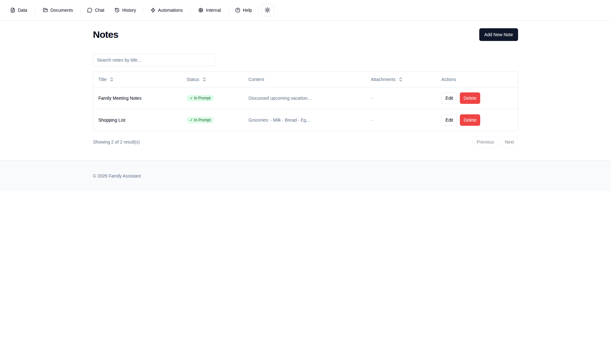
  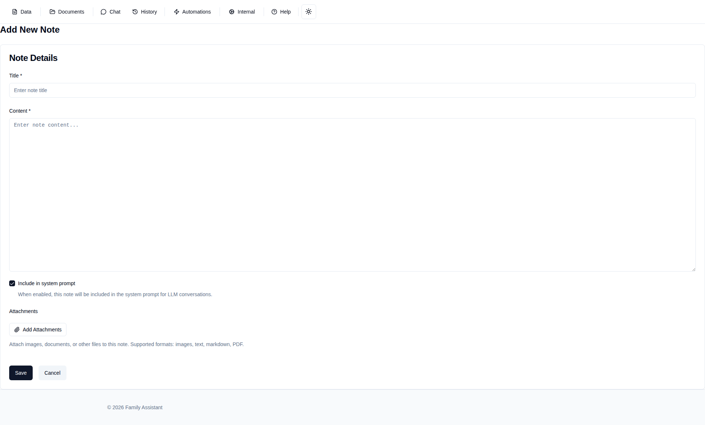

- **Documents** — every indexed document with its type, source, and metadata, linking through to the
  full text.

  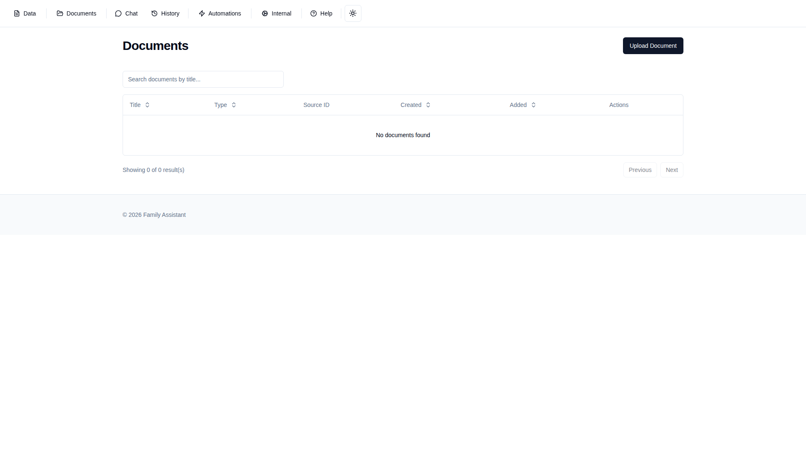

- **Vector Search** — semantic search across notes, emails, uploaded files, and indexed web pages.
  Results are grouped by document, and the detail view shows the full text at the top.

  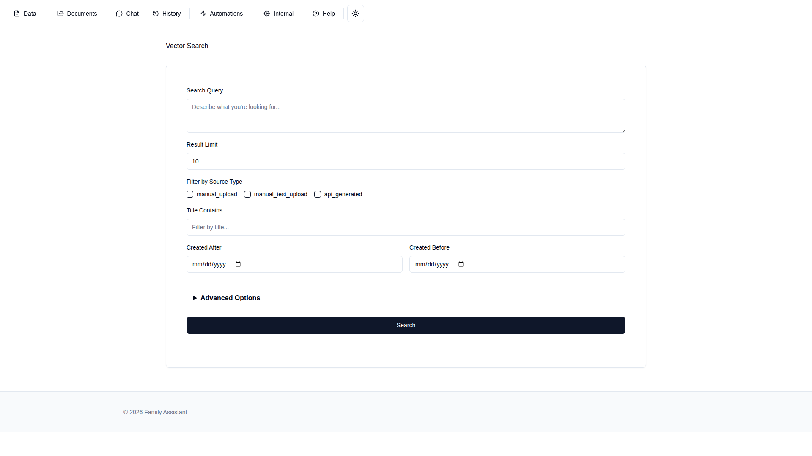

- **Upload Document** — add PDFs, text files, and other documents for indexing.

- **History** — past conversations across Telegram, web, and email, with filtering.

  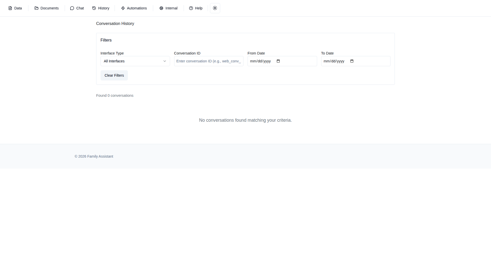

  Each message has a **Message Details** panel you can expand to see which mode answered, how many
  tokens the turn used, and — for models that report it — a **Thinking Summary** of the reasoning
  behind the reply. Not every model publishes a summary, so the panel only appears when one was
  recorded.

- **Tasks** — background and scheduled work, with the option to retry a failed task.

  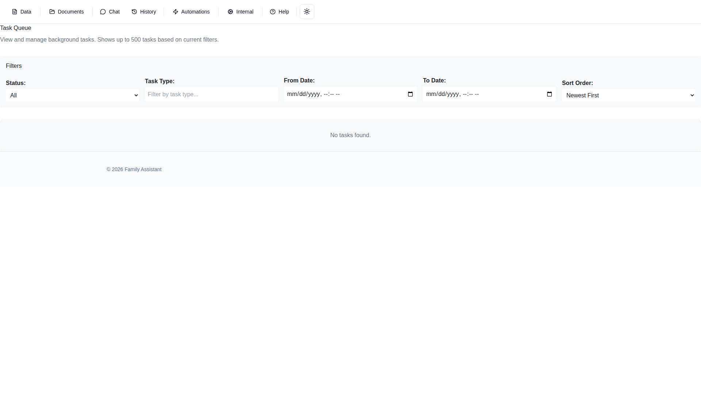

- **Automations** — create automations, review their configuration and run history, and enable,
  disable, or delete them. See [automations.md](automations.md).

  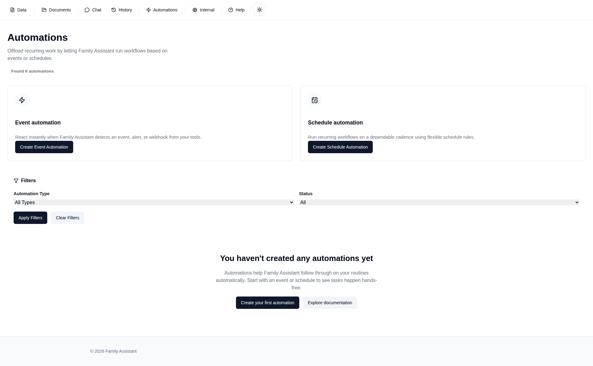

- **Tools** — inspect the available tools and their parameters, and test them directly.

  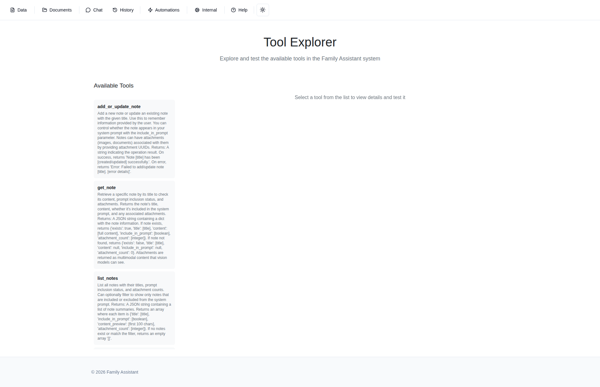

- **Settings → API Tokens** — manage tokens for programmatic access. Copy a newly created token
  while it is visible; **Copied!** confirms clipboard success. The list distinguishes active,
  expired, and revoked tokens. Revoking a token asks for confirmation; use **Cancel** or Escape to
  leave it active.

  

- **Settings → Connected Accounts** — link your Google account. See
  [google-workspace.md](google-workspace.md).

- **Error Logs** (`/errors`) — where whoever manages the assistant reviews reported problems. See
  [troubleshooting.md](troubleshooting.md).

## iOS app

The native app signs you in securely and opens on five tabs: **Chat**, **Voice**, **Notes**,
**Documents**, and **More**. Chat, Voice, and Notes are native screens; Documents and everything
under More open the corresponding pages in-app. Each tab remembers where you were.

**Links open in the app.** With the app installed, tapping a link to an assistant page — in a
message, an email, a notification, or a shared-conversation link someone sent you — opens it in the
app on the matching tab rather than in Safari. Links inside chat replies do the same. To view a page
in Safari instead, long-press the link and choose **Open in Safari**.

**Chat** shares the same conversation history as the browser. It streams replies, supports stopping
and steering, switches profiles (picking a profile starts a fresh conversation in it, carrying over
anything you have typed and attached; on a chat that is still empty it switches in place; reopening
an older conversation resumes its original profile), picks an intelligence level for the
conversation where the assistant offers a choice of them (see
[intelligence-levels.md](intelligence-levels.md)), renders Markdown and tool calls, handles
approve/reject confirmations, and uploads images, PDFs, plain text, and Markdown up to 100 MB. Very
long messages render a section at a time behind a **Show more** control.

**Home and threads.** Where your assistant has threads turned on, Chat opens on **Home**, one
ongoing conversation for quick questions and everyday requests. When the assistant moves a bigger
job into a thread, the thread appears in Home as a card. The card shows the thread's title, whether
it is working, waiting on you, done or failed, its latest line, and how many of its messages you
haven't read. A thread the assistant finished shows its outcome; one you closed yourself says "You
marked this done". When a thread finishes, its outcome also appears in Home under a **From thread:**
label; tap the label to open that thread. Tap a card to open the thread; Back returns you to Home
where you left it. A thread keeps its own profile, so it has no profile picker, and its top shows
the request the assistant started it with. To close a thread yourself, choose **Mark Done** from the
**…** menu at the top of the thread, or long-press its card in Home. It's offered while the thread
is **Waiting on you** or **Failed**; a thread that is still working can be marked done once it
stops. It reopens by itself when something new arrives in it.

Home and threads count as read once you have scrolled to their newest message with the app open, so
opening a thread clears its unread count. The **Chats** button at the top right (also in the menu at
the top left) counts threads waiting on you. It opens the chat list: Home, then your threads grouped
as **Waiting on you**, **Working**, **Failed** and **Done**, then all your other conversations,
including those from before threads, under **Earlier**. The list also has search and **New Chat**.
Something you share into the app lands in Home's composer. An intelligence level picked in Home
applies to that one message. See [Home and threads](#home-and-threads) for how threads work.

You can start and fill threads yourself:

- **New Thread**, at the top of the chat list: pick an assistant, write the opening message, and the
  thread opens with its first reply on the way.
- **Send as Thread**: long-press the send button in Home to send what you've written, with its
  attachments, as a new thread's first message instead. Pick the assistant next. The intelligence
  level you picked goes with it if that assistant offers the same level.
- **Continue in Thread**: long-press a message in Home. With **Bring this conversation** on, the
  thread starts with that exchange and up to four before it, and an opening message is optional.
  Some assistants (such as the browser) never see Home conversations; for those the thread starts
  from your opening message alone, and the sheet says so. The thread shows the message it started
  from at the top.
- **Move to Thread**: long-press a message in Home to move that whole exchange (your message and the
  reply) into an existing thread. Home keeps a **Moved to …** link in its place; tap it to open the
  thread. It's offered once no reply is in progress. Threads that can't take it are listed greyed
  out with the reason: one whose assistant doesn't see Home conversations, or one that is still
  working.

If the server refuses one of these, an alert says why, and nothing changes.

**Getting content in:** share a supported file from the iOS share sheet or Files "Open In" and it
opens a new Chat draft with the file attached. A copied image can be pasted with the paste button
beside the composer. The Photos share sheet does not list Family Assistant — copy the photo and
paste it, use the composer's photo button, or share from Files. Long-pressing the app icon offers
**New Chat** and **Voice** quick actions.

**Voice** asks for microphone permission and shows a level meter while capturing audio. A call runs
under the profile currently picked in Chat, and when it ends the transcript is saved as its own
conversation in that profile, including its tool calls and results — so opening it in Chat picks the
conversation up where the call left off. Quick delegated results are spoken in the call; later
results appear directly in Chat and can send a notification. Calls placed by Siri work the same way.

If you need something on your phone while talking, ask voice to **send it to my Chat**. It saves the
text in that call's conversation and sends a notification to your registered devices. For an HTTPS
link, such as directions, tapping the notification opens the link directly; the link also remains in
Chat for later. Other handoffs open the conversation when tapped. Notifications require the device
permissions described below and may be delayed or unavailable when push delivery is off.

If voice cannot connect on your iPhone or Apple Watch, tell the assistant approximately when you
tried and which device you used. The app sends connection-stage diagnostics automatically so the
failure can be investigated without connecting your device to a computer. These diagnostics exclude
audio, transcripts, instructions, tool arguments, and credentials. If delivery fails, queued reports
are retried when you next open voice mode or relaunch the app. Connection startup times out after 30
seconds instead of waiting indefinitely.

### Apple Watch

Install Family Assistant from the Watch app on your iPhone (watchOS 10 or later). Open the watch app
and tap **Set up with iPhone** while your paired iPhone is nearby and signed in to Family Assistant.
There is no server address or password to enter on the watch. If setup cannot connect, open Family
Assistant on the iPhone and try again.

After setup, voice works over whatever connection the watch has: its own Wi-Fi or cellular when your
iPhone is away, or the paired iPhone's connection when it is nearby. If sign-in expires, use **Set
up with iPhone** again. Signing out or changing accounts on the phone clears the watch's sign-in
when the devices next exchange updates; this is not immediate while disconnected. You can also
revoke the watch's credentials in API token settings.

Tap **Start Voice**, allow microphone access, and speak. The screen shows microphone activity and
the latest transcription. Use **Mute** to pause your microphone or **End** to finish. Leaving the
app ends the session. The transcript is saved to Chat when the session ends, and any handoff you
requested remains in that conversation.

To start from your watch face, edit the face, choose a complication slot, and select **Family
Assistant Voice**. Tapping its microphone opens the app and starts voice mode once you are signed
in. It supports circular, corner, inline and rectangular slots, depending on the face.

### Other native iOS features

**Notes** lets you search, read, create, edit, and delete notes, including whether a note is
included in the assistant's context automatically.

**Connection indicator:** a small indicator in the Chat toolbar shows the live-update state and
offers the right fix in one tap — *degraded* (updates lagging, tap to reconnect), *offline* (tap to
reconnect), or *sign-in required* (tap to sign in). Background sync problems surface there rather
than as pop-up dialogs; if the conversation list itself can't refresh, a small "Couldn't refresh —
last updated …" note appears at the top of the list. The list also refreshes by itself when the app
comes back to the foreground. A failed send shows a **Retry** button on the message itself; retrying
is safe and never sends twice. If Chat says **"authentication wall detected"**, open your Family
Assistant web address in Safari and complete any sign-in page, then return to the app and tap the
connection indicator to reconnect. If Safari cannot reach the sign-in page either, check your
connection and contact the person who manages Family Assistant.

**More** gathers Events, History, Automations, Tools, and a **Settings** screen with notification
controls and sign-out.

### Siri and Shortcuts

The iOS app provides actions you can run from Siri or the **Shortcuts** app with no setup. You must
be signed in first.

- **"Ask Family Assistant…"** — ask a question and get the reply inline. **Continue in app** opens
  the full conversation, which is useful if the assistant needs you to approve something.
- **"Capture this in Family Assistant"** — send text or a link for the assistant to save and file.
  Add it to a Shortcut with *Show in Share Sheet* enabled to capture from Safari, Notes, and other
  apps. Captured pages and emails are outside content, so the assistant handles them in a restricted
  mode: it can read your information to file things sensibly, but asks you to approve any change it
  wants to make.
- **"Add a note to Family Assistant"** — create a note by title and content.
- **"Open Family Assistant chat"** — open on the Chat tab, optionally starting a new conversation
  with a message.
- **"Call Family Assistant"** — start a spoken conversation, handled as a call. See **Hands-free and
  in the car** below.

These also appear as building blocks in Shortcuts, so you can combine them with other automations.

### Hands-free and in the car

Say **"Hey Siri, call Family Assistant"** to start a voice conversation without touching your phone.
It works with the app closed, as long as you have signed in at least once since the phone was last
restarted.

With the phone locked, the assistant answers only when the phone is connected to CarPlay — being
plugged into the car is what stands in for unlocking it. Otherwise, unlock the phone first; a call
from a locked phone away from the car shows up briefly and then fails. The same rule applies to
**"Ask Family Assistant…"**, which asks you to unlock rather than answering from a locked phone. An
ordinary Bluetooth car connection is not enough.

The conversation runs as a call, so it appears on the lock screen and on a CarPlay screen the way a
phone call does. Mute and hang up with the usual call controls, or end it from the app. An incoming
phone call takes over the audio and ends the assistant conversation.

The same tools are available as in any voice conversation, so anything that would normally ask you
to approve it first cannot run — start those from Chat instead.

## Messaging other people in your household

The assistant can pass a message to another person it knows, in whichever interface they use:

- "Tell Alice that dinner is ready."
- "Let Sam know I'll be twenty minutes late."
- "Send this photo to John."

It tells you what it sent and to whom. In a normal chat it sends straight away, so name the person
clearly. When the request originated somewhere less trusted — a forwarded email, say — it asks you
to approve the message first. See [confirmations-and-safety.md](confirmations-and-safety.md).

This only reaches people set up as users of your Family Assistant — it isn't a way to send ordinary
SMS or email to arbitrary contacts. The assistant can only message someone in a conversation they
have already used to talk to it, so a new household member needs to message the assistant once
before anyone can have a message passed to them.

## Push notifications

The assistant can reach you when the app isn't open.

- **Browser (PWA):** install the web app to your device and allow notifications.
- **iOS app:** notifications are off until you turn them on. Go to **More → Settings** and choose
  **Enable Notifications**, then grant permission when iOS asks. The app registers for Apple push
  notifications only after that.

You're notified when a new assistant reply arrives in a web conversation, a confirmation is waiting
for approval, a background task fails after retrying, a spawned worker task finishes, or a
long-running delegated task completes. Notifications go to every device you've registered.

**If you close the app mid-reply,** processing continues on the server and the finished reply
arrives as a push notification — tap it to jump back to the conversation. (You only get this push if
the connection actually dropped; watching the stream live doesn't produce an extra notification.)

**If the connection drops while a reply is streaming,** the app reconnects and continues the same
reply, or quietly reloads the finished reply from history. Opening a conversation whose reply is
still running — one you started on another device, say — streams it live from that point.

Documents and the pages in More use your iOS sign-in, including away from your home network. If a
page cannot connect, use Retry; if your credentials have expired or been revoked, use Sign in.

## Email

If your operator has configured it, you can email the assistant or forward mail to it. See
[email.md](email.md).

## Claude and other MCP clients

Claude on the web, Claude Code and programs on the Claude API can connect to the assistant and ask
it questions on your behalf. See [connecting-claude.md](connecting-claude.md).

## Delegation to specialist modes

For work better handled by a specialist — browsing, research, visualisation, complex planning — the
assistant may hand off to another profile. Quick handoffs come back inline. Longer ones return a
`delegation_...` reference and leave the conversation free; when the specialist finishes it wakes
the original assistant, which posts the follow-up in the same conversation. For voice calls, longer
handoffs post their result directly in Chat. You can ask for the status of a delegation reference at
any time.

While a longer handoff is running, the web and iOS chat show a small line above the message box for
each one — which specialist is working, how it is going (queued, working, how many of a council's
members have answered, finishing up) and when it started. Hover it on the web, or use VoiceOver on
iOS, to see what was asked. The line disappears once the result has been posted.

Delegations can also be continued, so a specialist keeps its earlier context — useful for a
follow-up question to a previous research delegation.

Files travel with a delegation in both directions. A photo, PDF or spreadsheet from your
conversation can be handed to the specialist to work on, and any file it produces — a chart, a
converted document — comes back attached to the reply in the conversation, ready to open or
download. This works the same way whether the specialist runs here or on another agent elsewhere.
Very large files are the exception: if one is too big to hand over, the assistant tells you rather
than quietly leaving it out.

Sometimes a delegation is reported as failed and then turns out to have worked after all: the
specialist runs elsewhere, and it can keep going — or finish — after the assistant has given up
waiting on it. When that happens the result is delivered to you later, in the same conversation, and
says that the task failed earlier and finished after all, so it makes sense even if you never saw
the failure notice. If a specialist reports that it finished but returns nothing at all, that is
treated as a failure rather than an empty answer.

A delegation the assistant stops waiting on is asked to stop, but it may not have: until the
specialist confirms it, the assistant will tell you the run timed out and that cancellation was
requested, rather than that it was cancelled.

If the follow-up can't be delivered on the channel you asked from — a result too long for the chat
app to accept, say — the assistant is told so and sends you something that does fit, such as a
shorter summary or a note it saved with the full text. The complete result is kept in the
conversation either way, so you can ask for any part of it.

This is separate from spawned worker tasks, which are isolated coding or computing jobs identified
by worker task IDs.
